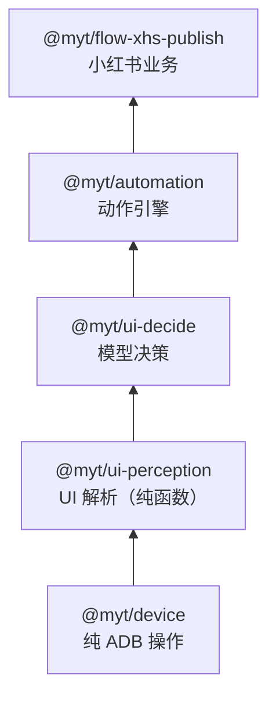

# 小红书图文发布流程（xhs.publish.image）

本文件记录 **发布功能包 `@myt/flow-xhs-publish`** 的实现。它是 `auto_object/auto_fb/auto_fb.py`
里 `fb_image` 的 1:1 移植，用于替代旧的 358 行单函数实现。

## 1. 包边界

发布与上号是两个**互不依赖**的功能包，唯一共同点是都用 `@myt/device` 这一层基础模块。

```
@myt/device（通用设备操作）
   ├── @myt/flow-xhs          上号：登录 / 改资料 / 绑手机 / 关注
   └── @myt/flow-xhs-publish  发布：图文 / 文字 / 长文笔记
```

删掉任何一侧都不影响另一侧。

## 2. 目录结构

```
packages/flow/flow-xhs-publish/src/
  locators/
    paths.ts              层级路径工具（nodeAtPath / centerOf / firstPoint）
    publish-locators.ts   发布全量定位器（路径常量 + 取值函数）
  steps/
    publish-actions.ts    粘贴 / 清空 / 回读校验 / 拟人点击
  flows/
    publish-image.ts      图文发布流程定义（16 步）
  index.ts
```

## 3. 模板字段映射

发布模板（`笔记发布模板文件.xls`）与流程入参的对应关系：

| 模板列 | 入参字段 | 说明 |
|---|---|---|
| 笔记类型 | — | 决定用哪个流程（图文 / 文字 / 长文） |
| 标题 | `title` | 空则跳过填标题步骤 |
| 正文 | `body` | |
| 话题(逗号分割) | `topics` | 代码里拼成 `\n#话题1 #话题2 ` |
| 图片/视频路径 | `imagePaths` | 文件夹会先展开成文件列表 |
| 文字笔记文字内容 | — | 仅文字笔记用 |
| 是否音乐图集 | `musicImg` | 为真才执行音乐图集步骤 |
| 魔云腾实例名称 | — | 由调度层决定目标设备 |

## 4. 十六个步骤

| # | 步骤 id | 旧代码段 | 轮询 | 失败行为 |
|---|---|---|---|---|
| 1 | `prepare` | 上传图片 + 输入法 + yadb | — | 抛错 |
| 2 | `open-profile` | 打开个人页等「我」 | 5 | 不抛错（沿用旧行为） |
| 3 | `wait-gallery` | 等相册加载 | 5 | 抛错 |
| 4 | `album-permission` | 允许访问相册 | 5 | 不抛错 |
| 5 | `pick-images` | 选图 + 滚动补选 | 10 | 抛错（选图不足） |
| 5.5 | `skip-image-editor` | 图片编辑页点「下一步」 | — | 不在编辑页则跳过 |
| 6 | `dismiss-chapter-dialog` | 加章节「我知道了」 | 5 | 不抛错 |
| 7 | `dismiss-mute-dialog` | 账号静音提示 | 5 | 不抛错 |
| 8 | `music-album` | 音乐图集（仅 `musicImg`） | 5 | 抛错 |
| 9 | `dismiss-mute-dialog-again` | 再关一次静音 | 5 | 不抛错 |
| 10 | `next-step` | 图文编辑页下一步 | 20 | 抛错 |
| 11 | `dismiss-album-location` | 相册内容定位弹窗 | 5 | 不抛错 |
| 12 | `fill-title` | 填标题（回读校验） | 6 | 抛错 |
| 13 | `focus-body` | 点正文输入框 | 6 | 抛错 |
| 14 | `fill-body` | 正文 + 话题（同框校验） | 3 | 抛错 |
| 15 | `submit` | 存草稿 / 发布 | — | 不抛错 |
| 16 | `verify-published` | 回主页校验（模型判断 + 代码兜底） | 9 | 抛错 |

共 **17 步**。

**注意**：段内 `for` 轮询与 `StepDefinition.retries` 语义不同，不得互相替代——
前者是「反复找同一个元素」，后者是「整个步骤重跑」。

## 5. 移植时修正的三个实际问题

### 5.1 权限弹窗点成了「允许有限访问」

Android 14 的权限弹窗有三个按钮，都含「允许」：

```
允许有限访问   ← 旧代码首条路径 [...,1,0] 落在这里
全部允许       ← 正确目标 [...,1,1]
不允许
```

旧关键词判据只看 `全部/all/允许/allow`，前两个都能通过。
**修法**：把「全部允许」路径提到候选首位，并增加 `DENY_KEYWORDS`
（`有限/部分/不允许/拒绝`）做排除。

### 5.2 删除不彻底，残留上一次输入

旧 `clear_phone_input` 删除次数是 `min(len+5, 20)`，20 的上限是按手机号
（11 位）场景定的。正文动辄几十字，20 次 DEL 删不干净，下一轮重输就变成
「旧内容 + 新内容」。

**修法**：去掉 20 的截断，改为 `len + 5`，并增加 `clearUntilEmpty`
（删完回读，没干净就补删）。

### 5.3 校验失败把已输入的正确内容删掉

设备回读的是 **CRLF**（`\r\n`），我们发送的是 `\n`：

```
expected = "正文\n#话题 "
actual   = "正文\r\n#话题 "
```

旧判据 `expected in actual` 因此失败，校验逻辑随即删掉已输入的内容，
最终框里只剩空白。

**修法**：比较前把 `\r\n` 归一化为 `\n`。

## 6. 输入框占位符陷阱

小红书把占位符直接写进 `text` 属性（没有 `hint`）：

| 输入框 | 空时 `text` |
|---|---|
| 标题 | `添加标题` |
| 正文 | `添加正文` |

若不归一化：

- 清空后回读得到「添加正文」，被当成「仍有残留」，永远删不干净
- `contains` 校验可能把占位符当成真实内容

**修法**：`firstInput` 把已知占位符归一化为空串。

## 7. Android 14 适配（A+B）

旧代码针对小红书内置相册；当前设备部分场景走系统 Photo Picker。
按旧设计的「多条候选路径」模式**追加**而非替换：

| 定位器 | 追加的候选 |
|---|---|
| `ALLOW_ALBUM_PATHS` | `[...,1,1]`（全部允许）提到首位 |
| `PHOTO_PICKER_GRID_PATHS` | `[0,0,0,0,0,0,0,2,0,0,0,0,0,0]`（系统 Picker 的 GridView） |

为了让 `is_gallery_page_present` 的 NAF 判据生效，`UiNode` 增加 `attrs` 字段
保留全部原始 XML 属性（`NAF` 是小红书自用属性，标准字段里没有）。

## 8. 实测结果

设备 `127.0.0.1:5565`，`fbMode = save`（存草稿）：

| 步骤 | 结果 |
|---|---|
| 1–15 | ✅ 全部通过（约 45 秒） |
| 16 `verify-published` | ❌ 未找到草稿或笔记 |

**第 16 步的原因**：该账号公开笔记为 0（页面显示「快发篇笔记来记录」），
而 `hasPublicNotesContent` 判的是公开笔记区域。草稿实际已保存成功
（`草稿箱·8`，草稿数从 7 变为 8）。

这一步按旧实现原样保留，未做修改。

## 9. 待办

- 文字笔记 `fb_wz` 流程
- 长文笔记 `fb_long_wz` 流程
- `@mention` 提及模式（`_is_mention_mode` / `_paste_body_with_mentions`）
- 模板 xls 解析与调度接入

---

# 补充：大模型工作流改写（2026-10-30）

把 16 步里的定位操作从「硬编码层级路径」改成「模型从候选列表选序号」。
模型不可用时回落到原路径，流程不中断。

## 实测：哪些步骤适合交给模型

| 步骤 | 交给模型 | 实测结果 |
|---|---|---|
| A 类 纯定位（标题/正文/下一步/存草稿/发布） | ✅ | 意图匹配名字 |
| B 类 有就点（我知道了/Cancel/全部允许/取消） | ✅ | 同上，且比路径抗改版 |
| `verify-published` 校验发布结果 | ✅ | 正确，1.2–1.5 秒 |
| `wait-gallery` 相册是否加载 | ✅ | 正确，1.2 秒 |
| `pick-images` 选图 | ❌ | 见下 |

### 选图为什么不适合交给模型

选中状态存在 XML 的 `selected` 属性里，候选列表不带这个字段。
角标数字（1、2）与它所属的图片是**兄弟节点**，靠坐标聚类无法可靠还原：

```
实测：手工补上「按行聚类 + 标出此行有选中」后，
      模型仍答 count=1，正确答案是 2。
```

所以 `pick-images` 保留原代码（`pickImagesByCount` 直接读 `selected`）。

## 实现

| 文件 | 作用 |
|---|---|
| `packages/ai/model` | 模型能力接缝 `ModelControl`（`complete(prompt)`） |
| `packages/ai/model-openai` | OpenAI 兼容 Provider（默认 Ollama `minicpm46`） |
| `steps/model-locate.ts` | `locateByModel`（定位，带路径兜底）、`askYesNo`（布尔判定） |

`StepContext.model` 与 `RunOptions.model` 是新增的可选字段，
不传时流程只能走确定性定位——这是「模型服务没起也能跑」的保证。

## 新增步骤：skip-image-editor

当前设备选完图会先进 `ImageEditActivity3`（滤镜/贴纸/拼图），
必须再点一次「下一步」才到发布编辑页。**旧代码没有这一步**
（旧版小红书选完图直达发布编辑页）。

按「A+B」原则补成独立步骤：先查前台是否在 `ImageEditActivity`，
不在就直接跳过，两种版本都能跑。

## 实测结果

| 轮次 | 结果 | 耗时 |
|---|---|---|
| 第 1 轮 | **17/17** | 93.3s |
| 第 2 轮 | **17/17** | 74.8s |

`verify-published` 从「一直失败」变为通过——模型正确判断了主页确实有笔记。

---

# 补充二：页面护栏与视觉兜底（2026-10-30）

## 问题一：没有页面判断

之前 17 步里只有 1 步检查页面，其余步骤拿不到目标就地空转，
或者把别的页面当成目标页面点击——实测出现过「图库里点『一键成片』」、
「首页上点发布按钮」，流程不报错，只是最后一步失败。

**修法**：新增 `steps/page-guard.ts`，每个步骤进入前先确认页面。

```ts
currentActivity(ctx)        // 读 dumpsys window 的 mCurrentFocus
currentPublishPage(ctx)     // → home/profile/album/photo-picker/image-editor/preview/post-editor/permission
assertPage(ctx, [...], 名)  // 不在期望页面就抛错
ensurePage(ctx, [...], n)   // 先按返回键归位
waitForPage(ctx, [...], ms) // 等页面切换（deeplink 是异步的）
```

| 步骤 | 允许的页面 |
|---|---|
| `prepare` | 归位到 home/profile |
| `wait-gallery` | 等 album/photo-picker/permission |
| `album-permission` | 只在 permission |
| `pick-images` | 只在 album/photo-picker |
| `dismiss-chapter-dialog` / `dismiss-mute-dialog` | 只在 post-editor/image-editor |
| `next-step` | 只在 image-editor（在 post-editor 直接跳过） |
| `fill-title` / `focus-body` / `fill-body` / `submit` | 只在 post-editor |

页面护栏立刻抓出了三个真实问题（下面第二节）。

## 问题二：视觉兜底没有接上

`ui-vision-listing` 早就实现了，但发布流程完全没引用。

**修法**：`locateByModel` 改成三级链路：

```
L1 文本定位（minicpm46 从候选列表选序号）
  ↓ 失败或命中不可点
L2 视觉兜底（截图 → cropOfRegion 裁剪 → 视觉模型读字 → 名字映射回候选）
  ↓ 失败
L3 调用方给的确定性路径（旧实现）
```

L2 纯 JS 实现裁剪（`png-crop.ts`，只用 Node 内置 `zlib`），不引入 sharp/jimp。

**实测**：主路径 6/6 命中时 L2 不触发，所以没有额外开销；
只有 L1 失败才付截图 + 推理的成本。

## 页面护栏抓出的三个真实 Bug

| Bug | 现象 | 根因 | 修法 |
|---|---|---|---|
| **首页被当成图库** | `wait-gallery` 判定通过，实际停在首页 | `collectGalleryGrid` 把顶部工具栏两个 48×48 图标当成图片格 | 加最小边长约束 `MIN_GALLERY_CELL = 120` |
| **点图片中心打开全屏预览** | 选图后进入 `MaterialPreviewActivity`，该页是纯 ImageView、抓不到任何控件，流程卡死 | 未选中时点的是格子中心 | 改为一律点**右上角角标区域** |
| **弹窗步骤误点后退** | `dismiss-mute-dialog` 在发布编辑页上找「Cancel」，点到后退，页面退回图片编辑页 | 没有页面护栏 | 弹窗步骤限制在 post-editor/image-editor |

## 当前设备的真实链路（与旧代码不同）

```
相册（选 1 张就自动跳）
  → MaterialPreviewActivity（纯 ImageView，抓不到控件）
  → ImageEditActivity3（滤镜/贴纸）
  → CapaPostNotePlatformActivity（发布编辑页）
```

旧版小红书是「相册 → 直接到发布编辑页」，所以旧代码没有中间两步。
`skip-image-editor` 负责推进：预览页用坐标兜底（`788,1544`），编辑页走模型定位。

## 实测结果

| 轮次 | 结果 | 耗时 |
|---|---|---|
| 第 1 轮 | **17/17** | 83.8s |
| 第 2 轮 | **17/17** | 69.7s |

---

# 补充三：文字笔记与长文笔记（2026-10-30）

## 三个流程的定位

| 流程 id | 旧函数 | 步数 | 入口 |
|---|---|---|---|
| `xhs.publish.image` | `fb_image`（358 行） | 17 | `xhsdiscover://post_note/` |
| `xhs.publish.text` | `fb_wz`（235 行） | 13 | `xhsdiscover://post_new_note?page={"page_type":"now_portal_home_page"}` |
| `xhs.publish.article` | `fb_long_wz`（220 行） | 12 | 同上，再点「写长文」 |

## 与旧代码的三处真实差异

| 差异 | 旧代码假设 | 当前版本实测 | 处理 |
|---|---|---|---|
| **写想法页 Activity** | 未指定 | `CapaPortraitEditV2Activity` | 页面识别的标识 |
| **文字笔记预览页** | 预览页后直达编辑页 | `CapaPictureReviewV3Activity`，要再点一次「下一步」 | `wait-preview` 循环直到 `post-editor` |
| **长文页没有「下一步」** | `get_next_button_position` 期待底部有「下一步」 | `LongNoteEditActivity` 只有「返回/写长文/标题/正文/一键排版」；发布入口是**点返回后的弹窗**：`不保存返回` / `存草稿` | 新增 `article-save-draft` 步骤 |

## 长文输入框路径（当前版本）

| 输入框 | 当前路径 | 旧代码路径 |
|---|---|---|
| 标题 | `[0,0,0,0,0,0,0,2,0,1]` | `[0,0,0,0,0,0,0,0,2,0,1]` |
| 正文 | `[0,0,0,0,0,0,0,2,0,0]` | `[0,0,0,0,0,0,0,0,2,0,0]` |

两条都保留：当前版本在前，旧版本在后（A+B 原则）。

## 新增的占位符

长文编辑页的输入框占位符也写进 `text` 属性，必须一并归一化，否则「删不干净」判定会永远失败：

- `粘贴到这里或输入文字，内容将自动保存`
- `输入标题`

## 意图要写候选里的精确文字

长文编辑页同时有「标题输入框」和「一键排版」，意图写「标题」时模型会选错。
必须写成候选里真实存在的文字：`输入标题`、`粘贴到这里或输入文字`。

图库页同理：`下一步(2)` 而不是「下一步」（后者会选到「一键成片」）。

## 实测结果

| 流程 | 步数 | 结果 | 耗时 |
|---|---|---|---|
| `xhs.publish.image` | 17 | **17/17** | 87.3s |
| `xhs.publish.text` | 13 | **13/13** | 94.4s |
| `xhs.publish.article` | 12 | **12/12** | 76.4s |

## 注册

`pack.ts` 实现 `FlowPack`，用 `registerFactory` 注册三个流程（内容来自模板行，每个实例参数不同）。
内核只需 `xhsPublishPack.register(ctx.flows, {})`，不持有任何具体流程 id。

**依赖边界**：`@myt/flow-xhs-publish` 只依赖 `@myt/device` / `@myt/flow` / `@myt/runs` / `@myt/human`，
不依赖上号包 `@myt/flow-xhs`——删掉任一包都不影响另一个。

---

# 补充四：异常恢复三层机制（2026-10-30）

## 为什么不用视觉模型判断异常

实测两种问法，都不可用：

| 问法 | 结果 | 耗时 |
|---|---|---|
| 整页截图 + 「这是什么界面、下一步做什么」 | **4/4 全错** | 20-26s |
| 整页截图 + 「有没有返回按钮」 | **2/4 对** | 20s |

**原因**：异常场景本身就是「没见过的页面」，模型对这类页面没有可靠先验。
（对照：正常页面上的布尔判断 `hasNote` / `loaded` 是 1.2-1.5 秒全对。）

## 三层递进

```
第 1 层  循环等待           页面正在跳转，再等等（41 处已有循环）
  ↓ 还不对
第 2 层  规则表             已知异常页面 → 预定义动作
  ↓ 没匹配到
第 3 层  通用回退           深链兜底 → 再逐级返回
  ↓ 还不对
          停下报错            人工补规则
```

代码：`steps/recovery.ts` 的 `recoverTo()`，被 `assertPage()` 自动调用。

## 恢复规则表

| 规则 | 匹配 Activity | 动作 |
|---|---|---|
| 系统权限弹窗 | `permissioncontroller` / `GrantPermissions` | 点「全部允许」 |
| 素材预览页 | `MaterialPreviewActivity` | 点 (788,1544)（纯 ImageView，抓不到控件） |
| 图片编辑页 | `ImageEditActivity` | 点「下一步」 |
| 发布预览页 | `CapaPictureReviewV3Activity` | 点「下一步」 |
| 系统 Photo Picker | `PhotoPickerUserSelectActivity` | 返回 |

## 关键：回首页用深链，不靠逐级返回

**实测**：`xhsdiscover://home` 能从任意深层页面（素材预览、图片编辑、发布编辑）
**直接回到 `IndexActivityV2`**，一次到位。

对照：逐级按返回键退 3 次，可能还停在相册页（中间还有预览页、编辑页）。

所以第 3 层是「先深链兜底，再逐级返回」。目标不是首页时传 `fallbackUri`，
避免「恢复成功但回到了首页」这种无效恢复。

**旧代码里没有这条深链**，是本次实测补的。

## 填写类步骤禁止自动恢复

`assertPage(ctx, [...], 名称, false)` 的第四个参数控制：

| 步骤类型 | 是否允许恢复 | 原因 |
|---|---|---|
| 打开/跳转类 | ✅ 允许 | 还没输入内容，退回去没损失 |
| **填写类**（标题/正文） | ❌ 禁止 | 已有输入内容，退回会丢数据，宁可失败重跑 |

实测教训：`dismiss-mute-dialog` 在发布编辑页上找「Cancel」点到返回键，
页面退回图片编辑页，已填内容全丢，还得重新选图。

## 实测效果

| 步骤 | 改前 | 改后 |
|---|---|---|
| `skip-image-editor` | 34.6s（自己写 6 轮循环） | **8.2s**（交给恢复层一条规则走完） |
| 图文全流程 | — | **17/17**，80.8s |

---

# 补充五：动作引擎（2026-10-30）

## 为什么要引擎化

改造前的五步（取界面→判页面→找坐标→执行→校验）**分散在 41 处循环里**
（图文 13、文字 10、长文 12，加恢复层 6），每个动作都要自己写等待、
自己写重试、自己写成败判断。

## 引擎的五步


`engine/run.ts` 的 `runAction()` 只写一次，动作定义只剩参数。

## 动作定义长什么样

```ts
{
  id: 'open-article-entry',
  title: '点「写长文」进入长文编辑页',
  requires: ['text-note'],                                                  // ② 前置页面
  locate: { intent: '写长文', fallback: getWriteArticleButtonPosition },     // ③ 定位
  act: { kind: 'tap' },                                                     // ④ 执行
  verify: { kind: 'page', expect: ['article-editor'] },                     // ⑤ 校验
  rounds: 6,                                                                // ⑥ 循环
  settle: [1.5, 2.5],
}
```

**里面没有任何循环、等待或 try/catch 代码。**

## 五种内置校验

| 校验 | 用途 |
|---|---|
| `page` | 页面变成目标页面（打开个人页、打开发布页） |
| `exists` / `gone` | 元素存在 / 消失（弹窗） |
| `inputEquals` | 输入框内容等于（或包含）期望文字（填标题、填正文） |
| `countAtLeast` | 数值达标（选图：已勾选数 ≥ 需要数） |
| `custom` | 覆盖不到的 10% |

## 两个关键开关

| 参数 | 作用 |
|---|---|
| `optional: true` | 「可能有也可能没有」的弹窗（try it 引导、静音提示），找不到也算成功 |
| `locate.strict: true` | 命中候选名必须与意图**字面相关**，否则视为未命中走兜底 |

**`strict` 是踩出来的**：默认模式下模型找不到目标会从剩余候选里挑一个最像的。
在发布编辑页找「取消」时，它选中了「返回」——一点就退回图片编辑页，整单失败。

同类误点实测记录（都是 `optional` 动作，失败时不报错，只把流程带歪）：

| 意图 | 实际命中 | 后果 |
|---|---|---|
| `取消` | 「返回」 | 退出图片编辑页 |
| `取消` | 「小组件浏览记录的按钮」 | 点了无关控件 |
| `试试看 try it` | 「返回」(62,92) | **把刚打开的长文编辑页退掉**，后续全判「页面不对」 |

**规则**：`optional: true` 的动作**必须**同时给 `strict: true`。

`optional` 只承诺「找不到算成功」，它不约束模型必须真的找不到才放弃——
没有 `strict`，模型会挑一个无关候选并点下去，而 `optional` 让这个误点
**不产生任何报错**，故障点因此漂移到几步之后。
这三个环节之前都是 `optional` 无 `strict`，现在全部补齐。

## 选图是一个动作，不是 N 个

选图是**有状态的批量操作**：要数当前勾了几张、不够要滚动补选、
滚两次还凑不够要放宽到前 9 张。拆成「选一张」的重复动作反而要把状态挪进引擎。

内部结构仍是「先算坐标列表 → 逐个点击」：

```ts
const points = pickImagesByCount(snapshot.root, remaining, maxVisible)  // [1,2,3,4,5]
for (const point of points) await tapHuman(ctx, point)                  // 循环点击
```

## 三个流程的文件位置

| 文件 | 步数 |
|---|---|
| `flows/publish-image.ts` | 15 |
| `flows/publish-text.ts` | 12 |
| `flows/publish-article.ts` | 11 |

共用动作在 `engine/shared-actions.ts`：`prepareEnvironment`、`submitNote`、
`verifyPublished`、`pullToRefresh`、`scrollAlbumPage`、`pickImagesAction`。

## 踩过的两个真实缺陷

| 缺陷 | 现象 | 修法 |
|---|---|---|
| **`parseLocateIndex` 不认字符串** | 模型输出 `{"index":"3"}` 时解析失败，整步失败 | 兼容数字、字符串、数组 |
| **输入动作双重循环** | 引擎 `rounds: 6` + `typeWithVerify` 内部 3 次 = 最多 18 次输入 | 输入动作 `rounds: 1` |

## 实测效果

| 指标 | 改造前 | 改造后 |
|---|---|---|
| 长文循环 | 12 | **4** |
| 长文等待 | 22 | **7** |
| 长文行数 | 362 | 294 |
| 长文结果 | 12/12，79.5s | **11/11，58.7s** |
| 图文结果 | 17/17，80.8s | **15/15，79.5s** |
| 文字结果 | 13/13，94.4s | **12/12，91.7s** |

---

# 补充六：移除全部硬编码坐标（2026-10-30）

## 问题

`tapAt` 类型和恢复层的 `tap` 动作都接受**写死的像素坐标**，换个分辨率或小红书的改版就必须手工重新获取。

## 排查结果

| 位置 | 情况 | 处理 |
|---|---|---|
| `engine/types.ts` 的 `tapAt` | **没有任何地方在用**，是预留能力 | 删除 |
| `recovery.ts` 的 `tap` 动作 | 定义了这个能力 | 删除 |
| 恢复规则「素材预览页 → tap(788,1544)」 | **规则本身已失效** | 删除 |

## 那条规则为什么失效

`MaterialPreviewActivity`（纯 ImageView，抓不到控件）是**早期误点图片中心造成的异常状态**。

修正后点的是**右上角角标**已实测验证：

```
点角标 (246,276) → 页面仍是 CapaAlbumActivity   ✅
```

选 2 张也仍是相册页。所以这个预览页在正常流程里**不会出现**，为它维护坐标规则没有意义。

## 滑动坐标改为按屏幕比例

| 动作 | 改前（写死） | 改后（按比例） |
|---|---|---|
| `scrollAlbumPage` | `input swipe 482 800 482 416 411` | x = 宽×0.535，y 从 高×0.5 → 高×0.26 |
| `pullToRefresh` | x 320-400、y 250-400 → 1100-1250 | x 宽×0.36-0.44、y 高×0.16-0.25 → 高×0.69-0.78 |

比例取自旧实现的实际值（482/900 ≈ 0.535 等），随机抖动保留。

## 结果

全局扫描确认 **`src/` 下已无硬编码像素坐标**（只剩注释里的历史记录）。

| 检查项 | 结果 |
|---|---|
| 图文流程 | 15/15，90.4s |

---

# 补充七：分层拆分（2026-10-30）

## 问题

引擎、定位、恢复、输入这些**全是安卓自动化通用能力**，却都放在 `@myt/flow-xhs-publish` 里，
别的业务包（抖音、快手）用不了。

## 拆分结果



| 包 | 职责 | 关键约束 |
|---|---|---|
| `@myt/ui-perception` | UI 树 → 候选目标 / 视觉列举 / PNG 裁剪 | **零依赖**：不碰设备、不碰模型，纯数据变换 |
| `@myt/ui-decide` | 意图 → 坐标 | 只依赖 `@myt/model` + `@myt/ui-perception` |
| `@myt/automation` | 五步循环、页面注册表、异常恢复、三级定位 | 不认识任何具体 App |
| `@myt/flow-xhs-publish` | 小红书定位器、页面表、恢复规则、三个流程 | 只依赖 `@myt/automation` |

## 关键改造：页面识别泛型化

**改前**：引擎里写死 `PublishPage`（12 个小红书页面）。

**改后**：业务包注册自己的页面表。

```ts
// 业务包（pages.ts）
export const XHS_PAGES: readonly PageSpec[] = [
  { id: 'post-editor', markers: ['CapaPostNotePlatformActivity'] },
  { id: 'album', markers: ['CapaAlbumActivity', 'entrancev2'] },
  { id: 'home', markers: ['IndexActivity'] },
  // ...
]

// 流程定义
app: {
  packageName: XHS_PACKAGE,
  homeUri: DEEPLINK_HOME,
  pages: new PageRegistry().register(XHS_PAGES),
  recoveryRules: XHS_RECOVERY_RULES,
}
```

**顺序很重要**：更具体的页面排在前面（`post-editor` 在 `album` 之前）。

### 内容兜底：Activity 认不出真实页面时

只有 `markers`（Activity 名）不够。实测小红书**长文编辑页内嵌在文字编辑页里**：
界面上已经是「输入标题 / 一键排版 / 粘贴到这里」，但 `mCurrentFocus`
仍然报旧的 `CapaPortraitEditV2Activity`（甚至 `IndexActivityV2`）。

按 Activity 判定就会得出「当前在 text-note」的结论，后续所有
`requires: article-editor` 的动作全部判失败。

所以 `PageSpec` 增加可选的 `contentMarkers`（界面上必须**同时出现**的文字）：

```ts
{ id: 'article-editor', markers: ['LongNoteEditActivity'],
  contentMarkers: ['输入标题', '一键排版'] },
{ id: 'text-note', markers: ['CapaPortraitEditV2Activity'],
  contentMarkers: ['写想法'] },
```

`currentPage` 的判定顺序：

1. `mCurrentFocus` 的 Activity 名匹配 `markers` → 直接用（快，绝大多数页面走这条）
2. 认不出时，取一次 UI 快照，用 `resolveByContent` 按 `contentMarkers` 判定
3. 都不中 → `UNKNOWN_PAGE`

`contentMarkers` 匹配按注册顺序取第一个命中，且要求**全部**特征文字都在。
所以 `article-editor` 必须排在 `text-note` 之前——两者都能看到「输入标题」以外的文字，
顺序错了长文页会被误判成文字页。

没有页面声明 `contentMarkers` 时不会取快照（`hasContentMarkers()` 短路），零额外开销。

## 恢复规则也搬到业务包

`recoverTo` 改成接收 `RecoveryConfig`（包名 + 首页深链 + 规则表）。
引擎不认识小红书，业务包提供自己的规则：

| 规则 | 匹配 | 动作 |
|---|---|---|
| 系统权限弹窗 | `permissioncontroller` | 点「全部允许」 |
| 素材预览页 | `MaterialPreviewActivity` | 点 (788,1544)（纯 ImageView，只能按坐标） |
| 发布预览页 | `CapaPictureReviewV3Activity` | 点「下一步」 |

## 上下文传递

`FlowDefinition.app` → `StepContext.app`，类型用 `unknown` 保持 `@myt/flow` 不依赖 `@myt/automation`（避免循环依赖），引擎侧做类型收窄。

## 验证

| 检查项 | 结果 |
|---|---|
| `tsc --noEmit` | ✅ |
| 图文流程 | **15/15** |
| 文字流程 | **12/12** |
| 长文流程 | **11/11** |

### 拆分后实测耗时

| 流程 | 步数 | 结果 | 耗时 |
|---|---|---|---|
| 图文 | 15 | 15/15 | 90.2s |
| 文字 | 12 | 12/12 | 73.5s |
| 长文 | 11 | 11/11 | 68.0s |

`fill-body` 偶尔到 30s 以上：`typeWithVerify` 在 `contains` 模式下要等正文写入完成后回读，
不通过就重输（最多 3 轮 × 4 次广播）。这是已知的耗时特点，不是缺陷。
