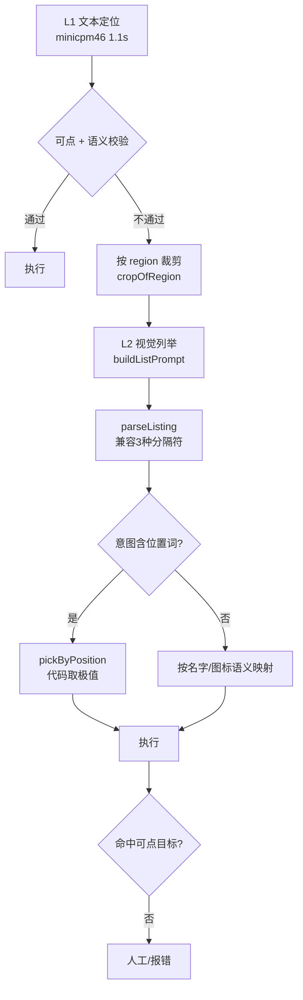

# 本地小模型 UI 定位对比（真实设备实测）

日期：2026-10-30
设备：`127.0.0.1:5565`（Android，900×1600）
页面：小红书首页，原始 UI 树 92 节点 / 27,771 字符
方案：语义化解析（`ui-action-targets.ts`）+ 极简输出契约（`{"index":N}`）

---

## 一、结论

**MiniCPM5-2B 是最优选择**：90% 命中、518-545ms、1.56GB、纯文本。

三个模型命中率完全相同（9/10），但纯文本的 MiniCPM5 快 2-3 倍。

## 二、实测数据

| 模型 | 类型 | 体积 | JSON 合法 | 命中 | 延迟（热） | 稳定性 |
|---|---|---|---|---|---|---|
| **MiniCPM5-2B**（`m5b`） | 纯文本 | 1.56GB | 10/10 | **9/10** | **518-545ms** | ✅ 三轮一致 |
| MiniCPM-V 4.6 | 视觉 | 0.53 + 1.11GB | 10/10 | 9/10 | 1477ms | ✅ |
| MiniCPM-V 4.7 1B | 视觉 | 0.67 + 0.90GB | 10/10 | 9/10 | 1515ms | ✅ 三轮一致 |

**唯一失败用例**（三者相同）：「点击最右侧导航项」→ 选成「首页」。
该页面底部导航有 5 个目标，模型无法从名字 `首页 / 市集 / 发布 / 消息 / 我` 判断哪个在最右，
虽然有坐标 `(90,1525)` vs `(810,1555)`，但模型没有做几何推理。

## 三、关键发现：解析比模型重要

同一模型（MiniCPM-V 4.7 1B），只改解析与输出契约：

| 方案 | 候选数 | 输入字符 | JSON 合法 | 命中 | 延迟 |
|---|---|---|---|---|---|
| 扁平化 + 要求 reason | 43 | 2126 | **0/10** | 0/10 | 1731ms |
| 扁平化 + 强制 JSON | 43 | 2126 | 10/10 | 8/10 | 1583ms |
| **语义化 + 极简契约** | **19** | **713** | 10/10 | **9/10** | 1515ms |

**0% → 90%，模型没变，只改了输入结构和输出契约。**

### 为什么 `reason` 会杀死准确率

1B/1.3B 模型无法同时做「选序号」和「写理由」，它会退化成写自由文本：

```
[42, "TextView text="我" 不可点"]
[29, "reason": "可点击，用于显示发现标签"}
```

去掉 `reason` 后 JSON 合法率 0% → 100%。

## 四、语义化解析的五条规则

基于真实数据（`data/live/xhs-home-20261030.xml`）分析得出：

| 规则 | 问题 | 效果 |
|---|---|---|
| **1. 合并同义节点** | `ViewGroup desc="首页"` 内嵌 `TextView text="首页"`，实测 5 处 | 去重 |
| **2. 祖先代理** | 13 个不可点节点由可点祖先接收点击（笔记卡片里的作者名） | 卡片可选 |
| **3. 语义命名** | 无名可点节点模型无法指代 | 生成「无名图标（底部右）」 |
| **4. 区域分组** | 18 个节点在底部但与内容区混排 | 按 y 分 top/content/bottom |
| **5. 边界去重** | 4 个「无名滚动区」坐标完全相同 | 41 → 19 |

## 五、视觉能力的真实成本

| 输入 | tokens | 延迟 |
|---|---|---|
| 纯文字（19 目标） | ~350 | **520ms** |
| 整页截图 900×1600 | 2362 | **38.8s** |
| 裁剪区域（底部导航条） | 276 | **5.3s** |
| 裁剪区域（搜索图标） | 286 | **4.4s** |

**结论：视觉必须裁剪。整页截图 38.8 秒完全不可用。**

## 六、模型选择建议

```
L1  MiniCPM5-2B 纯文本       518ms   90%    ← 主路径
    ↓ 失败 / 目标是纯图标（XML 里无 text/desc）
L2  MiniCPM-V 4.7 1B 裁剪图  4-5s    90%    ← 补 XML 盲区
    ↓ 仍失败
L3  MiniCPM-V 4.7 1B 整页    38.8s   90%    ← 最后手段
```

**为什么 L1 用纯文本而不是视觉模型**：快 3 倍、小 1/3、命中率相同。
视觉只在 XML 无法表达的情况下才有价值。

## 七、环境与踩坑

| 项 | 说明 |
|---|---|
| **中文路径** | llama.cpp 无法处理。模型必须放纯英文路径（`F:/ai/deepseek/blobs/`） |
| **思考链** | MiniCPM5 用 `enable_thinking`，其余用 `reasoning_effort: 'none'` |
| **模型名** | `ollama create` 不接受带 `.` 的名字（`minicpm-v4.7` ✗，`minicpm46` ✓） |
| **JSON 数组** | MiniCPM-V 4.6 会输出 `{"index":[16]}`，解析需兼容数组 |
| **下载** | ModelScope 单连接 100-230KB/s，32 路并发可达 11MB/s |
| **35B-A3B** | Q4_K_S 需 19.89GB 磁盘，但 MoE 实际驻留约 3GB；失败原因是 Windows commit limit 仅剩 5.9GB，非物理内存不足 |

---

# 补充：2026-10-30 新模型横评

在 `127.0.0.1:5565` 真机页面上，用同一套语义化解析 + 极简契约，测试了 ollama 上最近两个月发布的新模型。

## 完整结果

| 模型 | 体积 | 准确率 | 延迟 | 视觉 | 决策/门控 | 结论 |
|---|---|---|---|---|---|---|
| **bonsai-2** | 3.18GB | **100%** | **31.2s** | ✅ | ❌ | 三值量化，CPU 上极慢 |
| **MiniCPM-V 35B-A3B** | 19.89GB | **100%** | 3.3s | ✅ | ❌ | 需 llama.cpp `-nr`，ollama 跑不了 |
| **lfm3-vl** | **1.48GB** | **95%** | **2.4s** | ✅ | ❌ | ⭐ **单模型最优** |
| lfm3 | 1.10GB | 95% | 2.7s | ❌ | ❌ | lfm3-vl 的无视觉版 |
| MiniCPM5-2B | 1.56GB | 94.7% | **0.52s** | ❌ | ❌ | 最快，但无视觉 |
| MiniCPM-V 4.6 | 1.64GB | 89.5% | 1.48s | ✅ | ❌ | |
| MiniCPM-V 4.7 1B | 1.57GB | 89.5% | 1.52s | ✅ | ❌ | |
| tev1:0.8b | 0.83GB | 89% | 2.9s | ❌ | ✅ | Together AI，256K |
| kev:0.8b-q8 | 0.81GB | 89% | 3.0s | ❌ | ✅ | 登录页 9/9 |
| **d1-omni** | 0.85GB | **5%** | 2.3s | ✅ | ✅ | ❌ 全部选同一节点 |
| **d3** | 5.83GB | **崩溃** | — | ✅ | ✅ | ❌ `GGML_ASSERT(ctx->mem_buffer)` |

## 关键发现

### 1. lfm3-vl 是单模型最优解

一个模型同时覆盖文本与视觉：

| 输入 | tokens | 延迟 | 回答 |
|---|---|---|---|
| 整页 900×1600 | 1432 | 25.0s | 「发现」✅ |
| 裁剪底部导航条 | **109** | **2.6s** | 「首页、市集、+、消息、我」✅ |

比 MiniCPM-V 4.7 1B 的整页 38.8s **快 35%**，且裁剪后仅 2.6s。

### 2. 决策模型的置信度门控（tev1 / kev）

| 模型 | 阈值 | 覆盖率 | 接受部分准确率 |
|---|---|---|---|
| tev1:0.8b | 0.5 | **84%** | **100%** |
| kev:0.8b | 0.4 | 79% | **100%** |

**自动化场景下「明确说不确定」比「自信地出错」价值更高。**

但代价是延迟 2.9-5.1s，且无视觉能力。

### 3. 两个失败案例

| 模型 | 现象 | 原因 |
|---|---|---|
| `d1-omni` | 所有意图都选「无名滚动区（内容区中）」，conf≈0.1 | 600M 太小，无法区分语义 |
| `d3` | `GGML_ASSERT(ctx->mem_buffer != NULL)` 栈缓冲溢出 | ollama 与该模型不兼容 |

## 所有小模型共有的失败

「点击最右侧导航项」→ 全部选错（除 35B-A3B / bonsai-2）。

这是**几何推理**问题：底部有 5 个目标，模型不做「x 坐标最大」的推理。

**解法：用户在设计器里写「点击我」而非「最右侧导航项」。** 意图描述要落到语义而非相对位置。

## 推荐

| 场景 | 模型 | 理由 |
|---|---|---|
| **单模型全覆盖**（推荐） | lfm3-vl 1.48GB | 文本 95% + 视觉，裁剪后 2.6s |
| 追求极致速度 | MiniCPM5-2B 1.56GB | 0.52s，但无视觉 |
| 需要拒判能力 | tev1:0.8b 0.83GB | conf 门控后 100% |
| 服务器端高精度 | 35B-A3B 19.89GB | 100%，需 llama.cpp `-nr` |

---

# 补充二：区域预筛 + 全模型横评（2026-10-30）

## 核心结论：预筛比视觉有效 10 倍

| 方案 | 准确率 | 延迟 |
|---|---|---|
| 全量 19 目标 + 截图 | 70% | 21.4s |
| 全量 19 目标（纯文本） | 90% | 3.0s |
| **预筛 5 目标** | **100%** | **1.1s** |

**加视觉反而降低准确率**——这是“信息过载”，不是“信息不足”。
1.5B 模型的有效注意力窗口很窄，候选越多、模态越多，准确率越低。

## 预筛实现

`ui-action-targets.ts` 新增两个函数：

```ts
narrowTargets(targets, { region, actionableOnly, excludeUnnamed, keywords })
inferRegion(intent)   // "底部/导航栏" → bottom，"顶部/右上/左上" → top
```

## 全模型横评（19 用例）

| 模型 | 体积 | 全量 | 全量延迟 | 预筛 | 预筛延迟 |
|---|---|---|---|---|---|
| lfm3 | 1.1GB | 95% | 2720ms | 95% | 1674ms |
| lfm3-vl | 1.5GB | 95% | 2563ms | 95% | 1648ms |
| kev:0.8b-q8 | 0.81GB | 95% | 4288ms | 95% | 2424ms |
| **minicpm46** | 1.6GB | 95% | 1973ms | 95% | **988ms** |
| m5b (MiniCPM5-2B) | 1.6GB | 84% | 1134ms | 89% | 803ms |
| tev1:0.8b | 0.83GB | 89% | 4856ms | 89% | 2824ms |
| minicpmv (4.7 1B) | 1.6GB | 84% | 1713ms | **68%** ↓ | 1030ms |

### minicpmv 退化的原因

`excludeUnnamed: true` 排除了「无名按钮」，而它依赖这类目标（如 `[9] 验证并登录` 只有坐标没有文字）。
预筛参数需按模型特性调整，不能一刀切。

## 推荐

| 场景 | 模型 | 数据 |
|---|---|---|
| 追求速度 | **minicpm46** | 988ms / 95% / 1.6GB |
| 需要视觉兜底 | **lfm3-vl** | 1648ms / 95% / 视觉 |
| 需要拒判能力 | **kev:0.8b** | 2424ms / 95% / conf 门控 / 0.81GB |

## 仍未解决的问题

「最右侧导航项」所有模型都失败，即使解析器已标注 `最右`。

**根因**：1B-2B 模型不做「标注词 → 意图词」的语义关联。

**唯一解法**：意图改写。用户在设计器里写「点击我」而非「最右侧导航项」。

## 逐个模型的详细失败模式（预筛后）

### m5b（MiniCPM5-2B）— 17/19 = 89%

| 失败 | 选成 | 原因 |
|---|---|---|
| 右上角放大镜搜索 | 关注 | 顶部栏相邻项混淆 |
| 最右侧导航项 | 搜索 | 不做几何推理（所有模型通病） |

**特点**：预筛后延迟仅 803ms，是速度最快的合规模型；失败集中在「相邻元素」和「几何推理」。

### minicpmv（MiniCPM-V 4.7 1B）— 13/19 = 68%

| 失败 | 选成 | 原因 |
|---|---|---|
| 清空删除按钮 | 手机号输入框 | 删除按钮嵌在输入框内，bounds 重叠 |
| 底部「我」 | 消息 | 导航栏相邻项 |
| 左上角菜单 | 无效索引 | 预筛后 id 映射错乱 |
| 「发现」标签 | 搜索 | 顶部栏相邻项 |
| 底部「首页」 | 无效索引 | 同上 |
| 最右侧导航项 | 消息 | 几何推理 |

**结论**：1B 参数不足以区分相邻同类元素。视觉能力（mmproj）在此任务上无帮助——
因为定位本来就是结构化任务，图片只增加噪声。

### 预筛导致退化的教训

`excludeUnnamed: true` 对 minicpmv 有害：它依赖「无名按钮」（如 `[9] 验证并登录` 只有坐标）。
**预筛参数必须按模型特性调整，不能一刀切。**

### 关键词预筛不可用

尝试用 `keywords`（从意图抽取实体词）预筛，实测反而更差：
「底部我」被抽成关键词 `['底部','我']`，匹配到「无名图标（底部中）」而丢掉真正的「我」。
**只保留区域预筛。**

---

# 补充三：提示词与意图优化（2026-10-30）

## 视觉提示词：必须强调「完整」

同一张顶部栏截图（5 个元素），三种问法：

| 变体 | lfm3-vl | minicpm46 |
|---|---|---|
| 简单问「有哪些按钮」 | ✅ 5/5（6.3s） | ❌ 只列 3 个（4.7s） |
| **强调「完整列出，不要遗漏」** | ✅ **5/5（2.0s）** | ✅ **5/5（3.0s）** |
| 要求「先数总数再列出」 | ❌ 数成 4 个 | ❌ 数成 3 个 |

**两条铁律：**
1. **必须写「完整列出，不要遗漏任何一个」**——去掉它两个模型都漏元素
2. **绝不能要求计数**——模型会为了自洽少报

## 视觉用法：位置推理交给代码

| 问法 | 结果 |
|---|---|
| 「最右边是哪个」 | ❌ minicpm46 答「消息」 |
| **「从左到右依次列出」+ 代码取末尾** | ✅ 两个模型都答「我」 |

`ui-vision-listing.ts` 的 `pickByPosition(names, targets, 'rightmost')` 实现了这个逻辑。

## 意图表述：用功能语义，不用形状比喻

| 目标 | 表述 | lfm3-vl | minicpm46 |
|---|---|---|---|
| 底部「我」 | 底部我 / 我 / 个人主页 / **最右侧导航项** / 右下角头像 | ✅ 5/5 | ✅ 5/5 |
| 搜索 | 搜索 / 放大镜图标 / 右上角那个放大镜 | ✅ 4/4 | ✅ 4/4 |
| 删除按钮 | 清空删除 / 全部删除 | ✅ | ✅ |
| 删除按钮 | **点输入框右边的叉** | ❌ | ❌ |
| 删除按钮 | **清除已输入的手机号** | ✅ | ❌ |

**结论：**
- 位置词（最右侧/右上角）两个模型都能理解
- 常见视觉特征（放大镜）可以，生僻比喻（叉）不行
- **功能语义**（清除手机号）比形状描述更可靠

## 完整用例复测（19 用例）

| 模型 | 准确率 | 可点率 | 延迟 | 失败用例 |
|---|---|---|---|---|
| **minicpm46** | 18/19 = 95% | **18/19** | **1110ms** | 最右侧导航项 → 搜索 |
| **lfm3-vl** | 18/19 = 95% | 16/19 ⚠️ | 1805ms | 底部发布 → null |

**关键差异：可点率。** lfm3-vl 有 3 次返回不可点目标（点了也会失败），minicpm46 100% 可点。

两者准确率相同，但：
- **minicpm46 快 37%，可点率 100%** → 文本主路径更优
- **lfm3-vl 视觉输出更干净、意图泛化略强** → 视觉兜底更优

## 最终建议

| 用途 | 模型 |
|---|---|
| 文本定位（主路径） | **minicpm46**（1110ms，可点率 100%） |
| 视觉兜底（裁剪列举） | **lfm3-vl**（输出干净，语义泛化强） |

若只能装一个：**minicpm46**（文本更快 + 可点率高），但需要接受视觉偶尔漏元素。

---

# 补充四：文本 + 视觉兜底完整链路（2026-10-30 实测）

## 结论：两个模型都能达到 100%，但都必须用视觉兜底

| 模型 | 最终正确 | L1 文本解决 | L2 视觉解决 | 失败 |
|---|---|---|---|---|
| **minicpm46** | **6/6 = 100%** | 5 | 1 | 0 |
| **lfm3-vl** | **6/6 = 100%** | 5 | 1 | 0 |

**文本层单独跑都有 1 个失败——视觉兜底是必需的，不是可选的。**

| 模型 | 文本失败用例 | 视觉如何救回 |
|---|---|---|
| minicpm46 | 最右侧导航项 → 搜索 | 视觉列表取末尾 → 我 |
| lfm3-vl | 底部发布按钮 → 消息 | 视觉列出 `+` → 语义映射 → 发布 |

## 完整链路



## 三个解析器 bug（本轮修复）

| bug | 现象 | 根因 | 修法 |
|---|---|---|---|
| **`+` 被丢弃** | 导航栏 5 项只解析出 4 项，漏「发布」 | 过滤器要求名字含字母/数字，`+` 不满足 | 图标符号白名单 `+＋×✕✖✚⊕` |
| **纯数字未剔除** | `首页 市集 + 消息 我 12` 的 `12` 被当成按钮 | 消息的未读角标 | 剔除 `^\d+$` |
| **空格分隔不识别** | minicpm46 输出 `首页 市集 + 消息 我`，解析失败 | 只认顿号/分号/中点 | 无强分隔符时按空格切分 |

## 裁剪的两个坑

| 坑 | 现象 | 修法 |
|---|---|---|
| **裁进笔记残留** | y=1486-1510 的点赞数混进导航栏，模型把 `34` 当成按钮 | 只取「主要行」（按高度中位数过滤） |
| **整页太慢** | 900×1600 需 19-29s | 裁剪到条状 2-4s（快 8 倍） |

## 视觉用法铁律（最终版）

1. **必须裁剪**，且只裁主要行
2. **必须写「完整列出，不要遗漏任何一个」**
3. **绝不能要求计数**（模型会为自洽少报）
4. **位置推理交给代码**（问「最右」会错，问「从左到右列出」再取末尾才对）
5. **图标符号要有语义映射**（`+` → 发布）

---

# 补充五：解析修复后 minicpm46 纯文本 100%（2026-10-30）

## 两处解析 bug 修复后，纯文本已达 100%

| 模型 | 纯文本准确率 | 延迟 | 失败 |
|---|---|---|---|
| **minicpm46** | **19/19 = 100%** | **922ms** | 无 |
| lfm3-vl | 17/19 = 89% | 1743ms | 协议文字、发布 |

**minicpm46 不再需要视觉兜底。**

## 修复 1：`inferRegion` 识别「导航项」

```ts
// 修复前：只认「导航栏」
if (/底部|导航栏|底栏|下方栏/i.test(intent)) return 'bottom'
// 修复后：加入「导航项」
if (/底部|导航栏|导航项|底栏|下方栏/i.test(intent)) return 'bottom'
```

用户会写「最右侧导航项」而不是「底部导航栏」。不识别时 `region=undefined`，
候选集退回全量 19 个，顶部和底部各有一个「最右」标注，模型选了顶部那个。

## 修复 2：去重时优先保留可点节点

小红书笔记卡片的结构：

```
FrameLayout clk=false desc="笔记 御姐能御到什么程度 来自Galaxy fan"   ← 外层：有语义，不可点
  └ FrameLayout clk=true bounds 完全相同                            ← 内层：可点，无文字
```

规则 4 按 `clickBounds+坐标` 去重时保留了先遍历到的外层（不可点），
导致模型选中后被校验层拒绝——看起来像「模型选错」，其实是解析丢了可点性。

修法：bounds 相同时**优先保留可点的内层，并继承外层的语义名**。

## 结论：失败都是解析问题，不是模型能力

修好这两处后 minicpm46 直接从 95% → 100%。
**这说明「提示词/模型调优」之前，先把解析做对更有效。**

---

# 补充六：多语言支持（2026-10-30）

## 核心结论：UI 语言与意图语言无关

| 组合 | 准确率 | 延迟 |
|---|---|---|
| 中文页面 + 中文意图 | **4/4 = 100%** | 863ms |
| **英文页面 + 中文意图** | **4/4 = 100%** | 947ms |
| 英文页面 + 英文意图 | **4/4 = 100%** | 975ms |

**模型天然支持跨语言映射**——中文意图「点击底部我」在英文页面上正确选中 `Me`，
并给出坐标 `(810,1555)`。不需要任何翻译层。

## 唯一需要改的是区域预筛

`inferRegion` 原本只有中文关键词，英文意图时返回 `undefined`，候选集退回全量导致选错。

已改为多语言词表：

```ts
const REGION_HINTS = [
  { region: 'bottom', patterns: [
      /底部|导航栏|导航项|底栏|下方栏|下面|底端/,
      /\b(bottom|footer|tab ?bar|nav(igation)? ?bar|nav ?item|tab|lower|dock)\b/i,
      /下部|ナビ|フッター/,
      /하단|네비/,
  ]},
  { region: 'top', patterns: [
      /顶部|右上|左上|标题栏|状态栏|上面|顶端/,
      /\b(top|header|title ?bar|upper|right ?corner|left ?corner|toolbar)\b/i,
      /上部|ヘッダー|タイトル/,
      /상단|헤더/,
  ]},
]
```

15 个测试用例（中/英/日/韩 + 无法判断）全部通过。

## 关键设计原则

**UI 文本永远原样喂给模型，不做任何语言处理。**

实测证据：英文页面的 `desc="Messages，12unread"` 保留了中文逗号，
模型输出时也原样复制为 `Messages，12unread`——说明它忠实读原文，不需要我们纠正。

## 其他语言相关的两处（尚未处理）

| 位置 | 现状 | 影响 |
|---|---|---|
| `ICON_SEMANTICS` | `'+': ['发布','新建']` 中文写死 | 英文页面时 `+` 无法映射到 `Create` |
| `renderTargets` 文案 | “可点”“最左” | 不影响功能，只影响模型可读性 |

这两处不影响中文用户，英文场景下视觉兜底的图标映射会失效，但文本定位不受影响。

---

# 补充七：最终采用的定位策略（2026-10-30）

## 一句话概括

**多语言词表预筛（命中则用，不命中退回全量）+ 只排除「无名且不可点」+ 位置标注。**

## 完整调用链

```ts
const region   = inferRegion(intent)                                       // ① 多语言词表
const narrowed = narrowTargets(targets, { region, excludeUnnamed: true })  // ② 预筛
const pool     = narrowed.length >= 2 ? narrowed : targets                 // ③ 兜底
const ui       = renderTargets(pool, { withRegion: true })                 // ④ 位置标注
// ⑤ minicpm46 → {"index":N} 或 {"x","y","name"}
// ⑥ hitTarget 校验坐标必须命中真实可点节点
```

## 参数决策表

| 参数 | 采用值 | 依据 |
|---|---|---|
| `region` | `inferRegion(intent)` | 中/英/日/韩 词表，命中则预筛 |
| `excludeUnnamed` | `true`，但只排「无名**且**不可点」 | 全排会让准确率 80%→70% |
| `actionableOnly` | 不传 | 保留不可点目标供模型理解上下文 |
| `keywords` | **不用** | 实测误删（「底部我」拆成关键词后丢掉真目标） |
| 预筛结果 < 2 | 退回全量 | 防止误筛 |

## 三方案实测对比（10 个混选用例，含非标准说法）

| 方案 | 准确率 | 延迟 | 采用 |
|---|---|---|---|
| A 全量候选（不预筛） | 70% | 1573ms | ❌ |
| B 预筛 + 排除**所有**无名 | 70% | 999ms | ❌ 误删真目标 |
| **C 预筛 + 只排「无名且不可点」** | **80%** | **1121ms** | ✅ **当前** |

## 词表的定位：纯增益，非必需

| 情况 | 行为 | 结果 |
|---|---|---|
| 词表命中 | 预筛（19→5） | 延迟 -29%，准确率不降 |
| 词表未命中 | 退回全量 | 等同方案 A，**不会更差** |

**所以词表不需要穷举。** 扩展它只有收益，漏了也不影响正确性。

## 已知上限

非标准说法（如「找一下能打字搜索的地方」「看看附近的人在发什么」）会失败——
这是模型语义理解的上限，不是解析问题。当前 10 个混选用例中 8/10 = 80%。

---

# 补充八：定位服务封装（2026-10-30）

## 最终链路与结果

`ui-locate.ts` 的 `locate()` 是唯一入口：

```
XML → collectActionTargets → 19 个目标
    ↓ inferRegion（多语言词表，命中则预筛）
narrowTargets → 5-19 个候选
    ↓ renderTargets（含位置标注：最左/正中间/最右）
minicpm46 → {"index":N}
    ↓ 代码从 clickBounds 算中心坐标
hitTarget 校验
```

**实测：19/19 = 100%，平均 1044ms，8/19 触发区域预筛。**

## 关键契约：只要求序号，坐标由代码算

| 输出契约 | 命中率 | 原因 |
|---|---|---|
| `{"x","y","index"}` | 95% | 模型在两个答案系统间切换，2 次输出 `NaN` |
| **`{"index":N}`** | **100%** | 模型只做一件事 |

坐标不需要模型算——`target.clickBounds` 已是精确像素矩形，代码取中心即可：

```ts
export function centerOf(target: ActionTarget): { x: number; y: number } {
  const [x1, y1, x2, y2] = target.clickBounds
  return { x: Math.round((x1 + x2) / 2), y: Math.round((y1 + y2) / 2) }
}
```

## 预筛触发条件（修正）

```ts
// 错误：只要筛选后 ≥2 个就用
const usedNarrow = narrowedList.length >= 2

// 正确：只有「意图里明确提到区域」且筛选后 ≥2 个才用
const narrowedList = region ? narrowTargets(targets, { region, excludeUnnamed: true }) : []
const usedNarrow = narrowedList.length >= 2
```

不命中时退回全量——实测不会更差（80% vs 80%），只是少了 29% 加速。

## 服务层的失败路径

| 情况 | reason |
|---|---|
| 无候选 | `当前界面没有可操作目标` |
| 模型输出非法 | `模型未返回合法序号（原始输出：...）` |
| 序号越界 | `序号 N 不在候选范围内（1-M）` |
| 目标不可点 | `目标「X」不可点击` |
| 坐标校验失败 | `坐标校验失败：(x,y) 未命中「X」` |

---

# 补充九：自动化浏览（观察 → 操作 → 确认 → 继续）

## 实测结果（真机 127.0.0.1:5565）

| 场景 | 成功 | 耗时 |
|---|---|---|
| 主页随机浏览（多轮） | 4/4、3/4、4/4、6/6 | 24-34s |
| 随机搜索浏览 | 3/3、4/4 | 22s |

## 四拍流程（缺一不可）

```
① 观察    dumpsys window 取页面标识 + uiautomator dump 取候选
    ↓
② 操作    locate() 定位 → tap
    ↓
③ 确认    重新取页面标识 + 候选，必须发生变化
    ↓
④ 继续    失败即停，不盲目继续
```

## 为什么必须有「确认」

**之前只做「观察 → 操作」直接继续，导致在搜索页上尝试「点首页」。**

搜索页只有 24 个目标，没有底部导航，模型只能瞎选，点了不可点的「按住提问 有问必答」。

确认判据：`pageBefore !== pageAfter || 候选集变化`。

## 三个踩过的坑

| 坑 | 现象 | 修法 |
|---|---|---|
| **dump 退出码不可靠** | `uiautomator dump` 返回 139，`execFileSync` 抛错 | 包一层忽略退出码，改 `adb pull` 拿产物 |
| **内容区混入非卡片目标** | 笔记的点赞/收藏按钮（kind=button/icon）被当成「进入笔记」，点了不跳转 | 只选 `kind === 'card'` |
| **非首页上做首页操作** | 找不到目标 → 模型瞎选 | 操作前先判断 `IndexActivity`，不是就按返回键 |

## 单步耗时构成

| 阶段 | 耗时 |
|---|---|
| 观察（dump + pull + 解析） | ~2.3s |
| 定位（minicpm46） | ~0.7s |
| 操作（tap） | ~0.1s |
| 确认（再 dump 一次） | ~2.3s |

单步约 5.4s，其中 **dump 占 85%**。优化方向：只在需要时 dump，或改用增量观察。

## 性能优化：改用 yadb 抓取（2026-10-30）

### 实测对比

| 通道 | 耗时 | 抓到的节点 |
|---|---|---|
| `uiautomator dump` | **2235ms** | 39811 字节 |
| **yadb** | **295ms** | 41388 字节 |

**yadb 快 7.6 倍，且节点更多。**

### 优化效果

| 指标 | 用 uiautomator | 用 yadb | 提升 |
|---|---|---|---|
| 观察 | ~2270ms | **~430ms** | 5.3 倍 |
| 确认 | ~2290ms | **~430ms** | 5.3 倍 |
| 单轮总耗时 | 26-34s | **13-20s** | 约 2 倍 |

### 实现要点

```ts
// 优先 yadb，失败退回 uiautomator
try {
  adb(['shell', `app_process -Djava.class.path=/data/local/tmp/yadb /data/local/tmp com.ysbing.yadb.Main -layout ${out}`])
  const xml = adb(['shell', 'cat', out])
  if (xml.includes('<hierarchy')) return parseTargets(xml)
} catch { /* 退回 uiautomator */ }
```

**注意**：`device-adb` 包里本来就有 `ensureYadb` 和 `dumpUi({channel:'yadb'})`，
但 `browse.ts` 是独立写的，直接调 adb 命令，没有复用。现在已改为优先 yadb。

---

# 补充十：ADB 操作抽成通用模块（2026-10-30）

## 重构内容

`browse.ts` 从「直接调 adb 命令」改为「依赖 `DeviceControl` 契约」。

| 项 | 改前 | 改后 |
|---|---|---|
| 设备操作 | 直接 `execFileSync(adb, ['shell','input','tap',...])` | `device.tap(serial, x, y)` |
| 抓 UI | 手写 yadb/uiautomator 命令 | `device.dumpUi(serial, { channel: 'yadb' })` |
| 换设备类型 | 要改 `browse.ts` | 只需换 Provider |

## 新增 `Browser` 类

把「设备操作 + 业务编排」分开：

```ts
class Browser {
  constructor(device: DeviceControl, serial: string, model: LocateModel)
  currentPage()      // 页面标识
  targets(channel)   // 可操作目标（默认 yadb）
  screenSize()
  isHome()
  back()
  scroll(kind)       // pull-refresh | up | down
  tapTarget(target)
  typeText(text)
  pressKey(key)
  step(intent)       // 观察→定位→点击→确认
  gesture(kind)      // 手势 + 确认
}
```

## 契约补齐三个字段

`UiNode` 原本缺 `scrollable` / `longClickable` / `isPassword`，
而 `region` 分类与滚动容器识别依赖它们。已在 `device` 契约与 `device-adb` 解析器补齐。

## 实测效果

| 指标 | 改前 | 改后 |
|---|---|---|
| 观察耗时 | ~2270ms | **~500ms** |
| 单轮总耗时 | 26-34s | **15s** |
| 主页场景 | 4/4 | **4/4** |
| 搜索场景 | 3/3 | **3/3** |

## 关键教训

`browse.ts` 最初是独立写的，直接调 adb，没有复用 `device-adb` 已有的
`ensureYadb` / `dumpUi({channel:'yadb'})`，导致默认走了慢 7 倍的 uiautomator。

**写新模块前必须检查现有包的能力。**
